# GETH — Geth Engine for Tracking Hardware

GETH is a fast, lightweight terminal dashboard that watches your whole
machine in real time — CPU, every GPU, memory, power, temperatures, disk and
network — with live graphs, built for transparent and blurred terminals.

<!-- HERO: when docs/screenshots/hero.png is provided, replace the image src
     below with docs/screenshots/hero.png -->
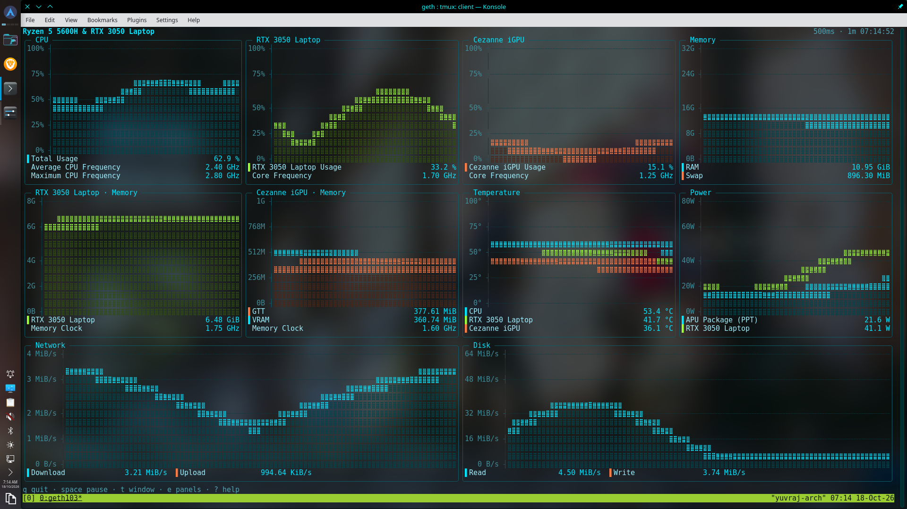

## Contents

- [What it is](#what-it-is)
- [What it is NOT](#what-it-is-not)
- [Features](#features)
- [Screenshots](#screenshots)
- [Supported hardware](#supported-hardware)
- [Install on Arch](#install-on-arch)
- [Build from source](#build-from-source)
- [Building the Arch package](#building-the-arch-package)
- [Usage](#usage)
- [Configuration and themes](#configuration-and-themes)
- [Logging to CSV](#logging-to-csv)
- [CPU power permissions](#cpu-power-permissions)
- [Hybrid laptops: discrete-GPU sleep](#hybrid-laptops-discrete-gpu-sleep)
- [Troubleshooting / FAQ](#troubleshooting--faq)
- [Contributing](#contributing)
- [License](#license)
- [Acknowledgements](#acknowledgements)

## What it is

A lightweight terminal dashboard for **CPU, GPU (multiple), memory, power,
temperature, disk and network** with real-time graphs. It is inspired by the
KDE System Monitor and built for transparent/blurred terminals: GETH never
paints a background color or inverts text, so it sits cleanly over any
terminal theme.

No subprocesses: everything is read in-process from `/proc`, `/sys`, or NVML
(loaded with `dlopen`, never linked). Written in C++20; the only build-time
dependencies are fetched by CMake and pinned to exact versions (see
[docs/DEVELOPMENT.md](docs/DEVELOPMENT.md)).

## What it is NOT

- **Not a process manager** — no per-process list, kill, or rename.
- **Not an alerting / remote-monitoring daemon** — no thresholds, no network
  server, no always-on history. What you see is live, local sampling; the
  optional CSV logger records only what you have chosen to view, and only
  while you ask it to (see [Logging to CSV](#logging-to-csv) below).
- **Linux only.**
- **No Intel GPU backend yet** — Intel iGPUs are *detected* (they show in
  `--probe`) but not *sampled*; their panels show "—" until a backend lands.
- **No root needed** — for anything except optionally making RAPL CPU
  package power readable without a root account.
- **Never wakes a sleeping laptop dGPU** — a suspended NVIDIA card is shown
  with its last known values, not polled awake.

## Features

- **Charts & metrics** — a live chart per panel, with a `g` key that
  cycles the graph mode (saved to the config). Two line-chart renderers and
  a steps mode: when the terminal speaks the Kitty graphics protocol (or
  Sixel), each graph is a pixel image — smooth anti-aliased lines, a soft
  translucent fill, faint gridlines on a transparent background; otherwise
  the text fallback is a solid area chart for single-series panels and
  one-dot braille lines for multi-series ones. **Steps** (an nvtop-style
  step-line chart) draw the history as box-drawing characters — one data
  point per column, newest at the right edge, square-cornered steps with no
  fill and no braille; always text-rendered, so they work in any terminal.
  The metrics: CPU usage (with per-core), frequency, temperature, package
  power, RAM/swap, GPU usage and memory (GTT vs VRAM on integrated AMD
  GPUs), disk and network rates. Series that share a panel always get
  distinct colors. Gaps (suspend, clock jumps) blank the rate series for
  that tick instead of showing a bogus spike.

  | text | pixels (Kitty) | steps (nvtop-style) |
  | ---- | -------------- | ------------------- |
  | 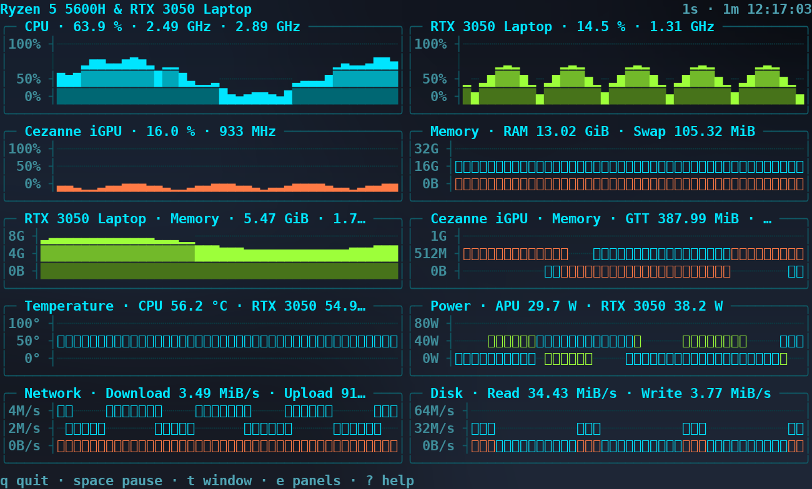 | 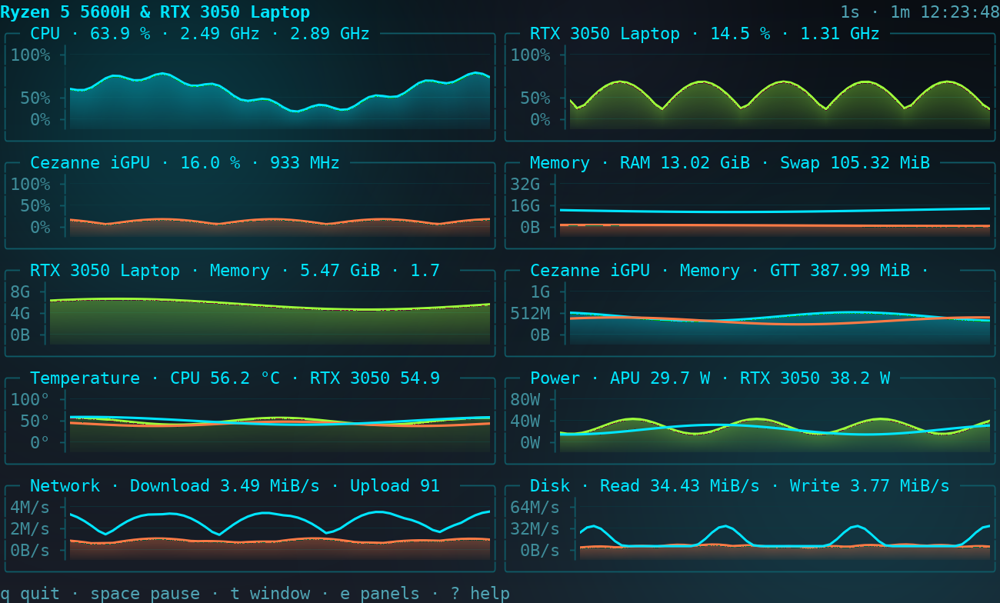 | 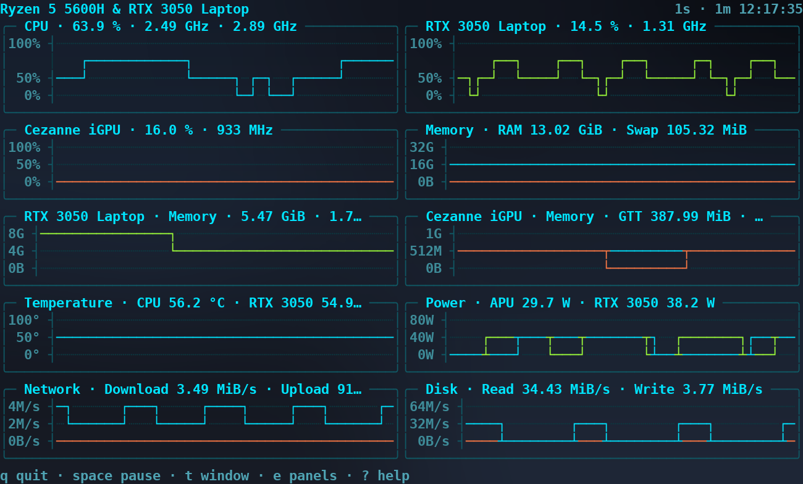 |
- **Multi-GPU** — one usage panel and one memory panel per detected card
  (AMD and NVIDIA, integrated and discrete); GPU renames in the panel
  manager are global (every panel, legend, and the header for that bus).
- **Power** — CPU package power from RAPL → `amd_energy` → `zenpower` → APU
  PPT fallback (the APU PPT already includes the iGPU); NVIDIA package power
  from NVML. See [CPU power permissions](#cpu-power-permissions).
- **Responsive layout** — the layout engine reflows to the terminal size and
  pinned column count; each panel degrades gracefully (full graph → compact
  → scrolling) as space shrinks. The decision is inspectable with
  `--layout-report`.
- **Panel manager + config** — `e` opens the manager: show/hide, reorder,
  rename, per-series visibility. Every change is saved to a TOML config
  (atomic writes; unknown keys are warned, never an error).
- **Themes + transparency** — five built-in 24-bit themes, custom themes
  from `$XDG_CONFIG_HOME/geth/themes/*.toml` with inheritance, live cycling
  (`T`), and automatic 256/16-color fallback that keeps the six series
  colors in distinct 16-color slots.
- **Performance** — measured on the dev machine (Ryzen 5 5600H, Release
  build): ≈ **0.5% CPU** and ≈ **7 MB RAM** at idle, ≈ **35 ms** from launch
  to first frame; re-layout of 50 random sizes averages well under a
  millisecond, and the layout cache reuses its result with zero allocations
  when the size is unchanged (`--perf`).

## Screenshots

Static renders via `--render-png` — deterministic demo data (60 s of
warm-up samples; the demo hardware: Ryzen 5 5600H, Cezanne iGPU, RTX 3050
Laptop) composited to an 8-bit RGB PNG, so every shot is the app alone,
with no terminal chrome or desktop behind it. Theme and layout shots use
the steps renderer (nvtop-style step-line charts); the panel manager and
help shots use the text renderer with the overlay open over the live
panels. Grid sizes: 200×56 (themes, manager, help), 230×68 (wide),
108×30 (narrow), 83×23 (compact). The same command produces CI-style
frames in any color mode — see `--render-frame`, `--render-png` and
`tools/frame2png.py` in [docs/DEVELOPMENT.md](docs/DEVELOPMENT.md).

| Cyberpunk Blue (default) | Matrix Green |
|---|---|
|  | 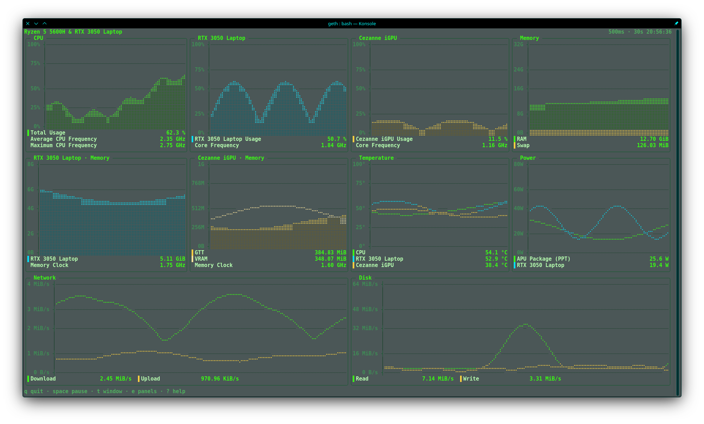 |

| Crimson Red | Amber |
|---|---|
| 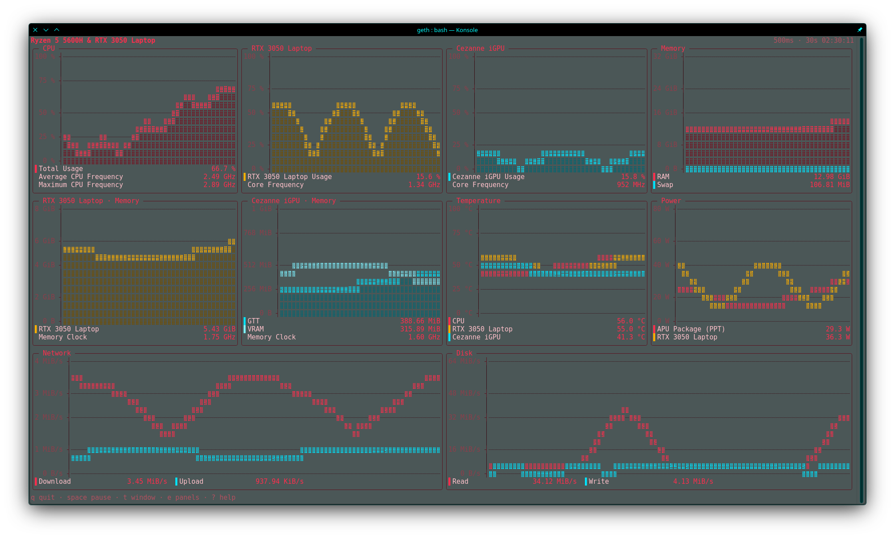 | 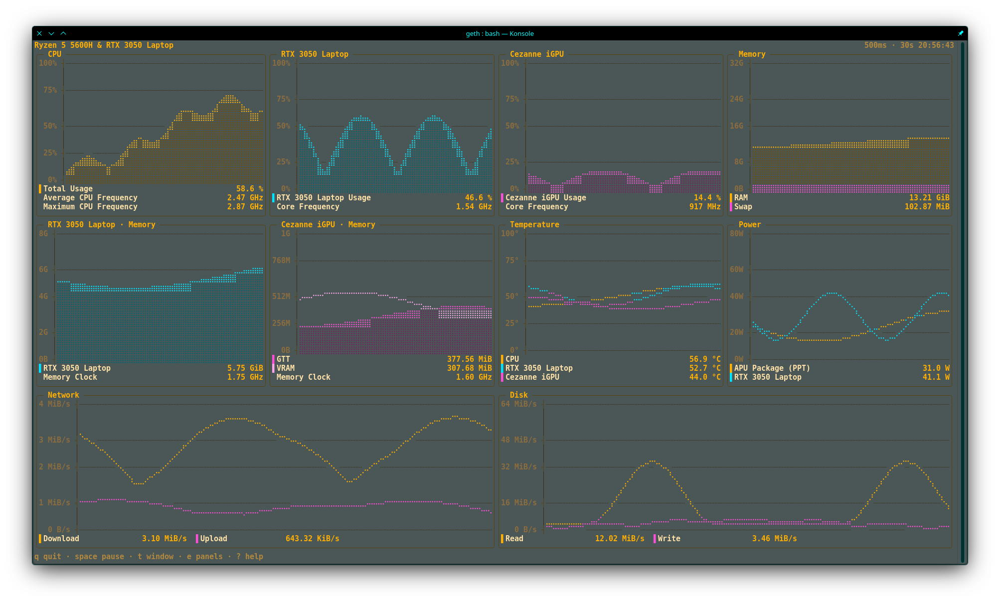 |

| Blaze Orange | |
|---|---|
| 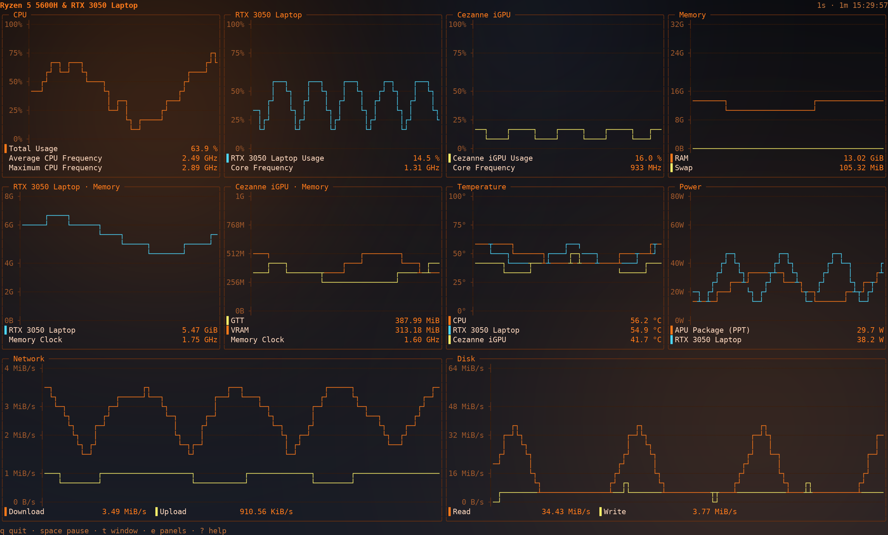 | |

| Panel manager (`e`) | Help (`?`) |
|---|---|
| 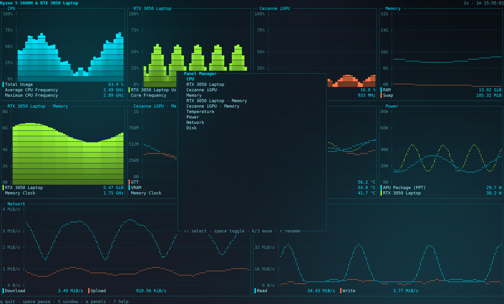 | 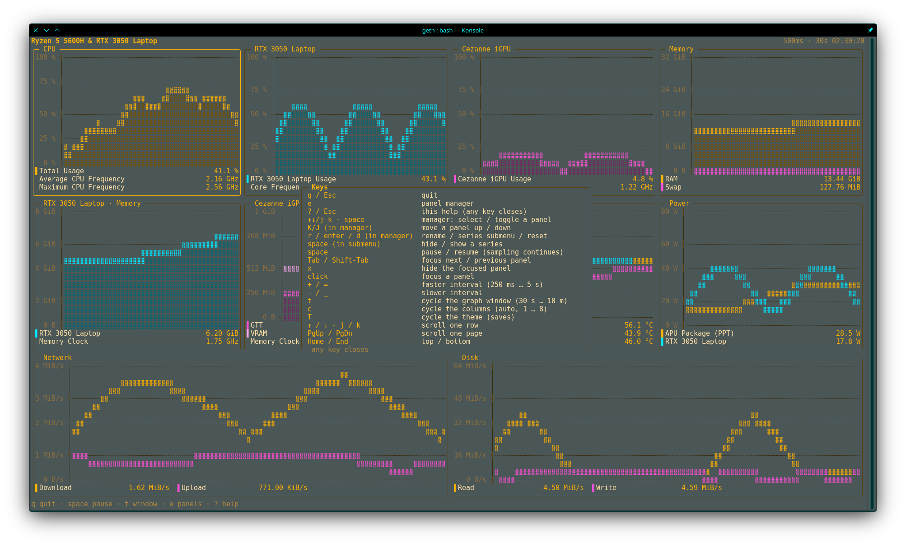 |

| Wide (230×68) | Narrow (108×30) | Compact (83×23) |
|---|---|---|
| 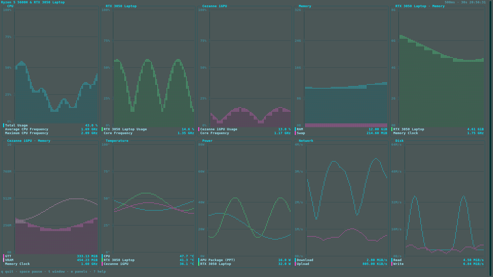 | 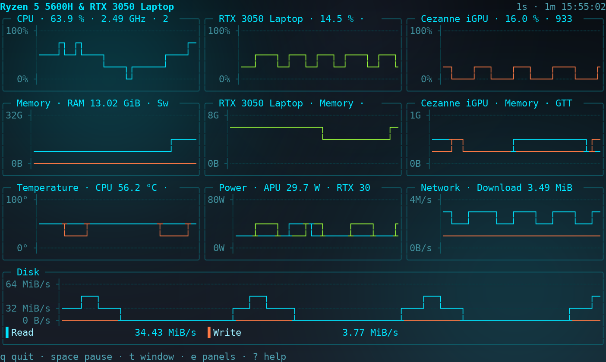 | 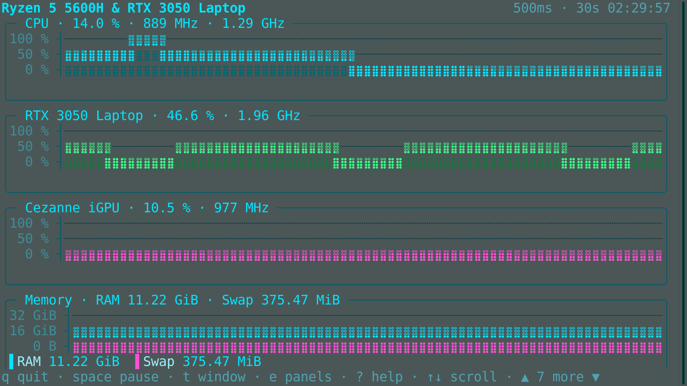 |

## Supported hardware

All metrics are read in-process. `--probe` lists every source on the current
machine, whether it is available, and why not — with fix hints. Full table
and the RAPL/powercap details: [docs/HARDWARE.md](docs/HARDWARE.md).

**Tested** (dev machine):

| Machine | CPU | iGPU | dGPU |
|---|---|---|---|
| Hybrid laptop | AMD Ryzen 5 5600H (APU) | Radeon Vega 7 (Cezanne) | NVIDIA GeForce RTX 3050 Laptop |

**Expected** (same interfaces, not personally tested yet):

- AMD Ryzen 7 260 + Radeon 780M + NVIDIA GeForce RTX 5060 Laptop (hybrid)
- AMD Ryzen 7 5800X + NVIDIA GeForce RTX 3070 (desktop, no iGPU)
- Other AMD/Intel CPUs with standard `/proc` + `hwmon` interfaces
- NVIDIA GPUs under the proprietary driver (NVML)
- AMD GPUs under `amdgpu` (including integrated iGPUs)

## Install on Arch

Build the package first (next section), then:

```sh
sudo pacman -U dist/geth-1.5.3-1-x86_64.pkg.tar.zst   # install
sudo pacman -R geth                                   # uninstall
rm -r ~/.config/geth                                  # remove your config (optional)
```

`pacman -R` removes exactly the package's files; your config in
`~/.config/geth` is always yours to keep or delete manually.

## Build from source

Build prerequisites:

| Distro | Packages |
|---|---|
| Arch | `base-devel cmake git` |
| Debian/Ubuntu | `build-essential cmake git` |
| Fedora | `gcc-c++ cmake git` |

Compiler: GCC ≥ 11 or Clang ≥ 14 (C++20). CMake ≥ 3.20.

```sh
cmake -B build -DCMAKE_BUILD_TYPE=Debug        # ASan+UBSan, -O1 (default)
# or
cmake -B build-rel -DCMAKE_BUILD_TYPE=Release  # -O2
cmake --build build -j
ctest --test-dir build --output-on-failure     # unit tests
./build/geth --demo                            # run it
```

FTXUI, toml++, and doctest are fetched into the build directory (pinned
versions, checksum-verified); nothing is installed system-wide. zlib is a
system library (the pixel renderer's image payloads and `--render-png`):
Arch `zlib`, Debian/Ubuntu `zlib1g-dev`, Fedora `zlib-devel`.

Install to a prefix (user-local or system):

```sh
cmake --install build-rel --prefix ~/.local     # or /usr/local (root)
cmake --build build --target uninstall          # remove exactly the manifest files
```

The install never touches `/etc` or your `~/.config/geth`. If Go Ethereum's
`geth` client is also on the system, build under a different name:
`cmake -B build-rel -DCMAKE_BUILD_TYPE=Release -DGETH_BINARY_NAME=geth-engine`.

## Building the Arch package

Needs `base-devel` (makepkg + a C++ compiler) and cmake. From a **clean**
tree (the tarball is a `git archive` of HEAD):

```sh
tools/package-arch.sh
# or, from a configured build:
cmake --build build-rel --target package-arch
```

The script checks the PKGBUILD's `pkgver` and `license=` against the single
version/license definitions in `CMakeLists.txt` (a mismatch fails the build),
archives the commit, fetches the pinned dependency tarballs (checksummed,
cached), and runs `makepkg -f --cleanbuild` — with **no network access in
`build()`**. Output:

```
dist/geth-1.5.3-1-x86_64.pkg.tar.zst
dist/SHA256SUMS
```

## Usage

```sh
geth                        # interactive dashboard (default)
geth --demo                 # synthetic data, no hardware touched
geth --probe                # which sources work on this machine, and why
geth --dump --interval 1000 # human-readable samples
geth --json --count 5       # JSON, one object per sample
geth --render-frame 160x48  # render one frame at that size and exit
geth --render-png 200x56    # composite one frame to an 8-bit RGB PNG (stdout)
geth --probe-terminal       # which image protocol (kitty/sixel), cell size
geth --renderer pixels      # force the graph mode for this run (not saved)
geth --renderer steps       # nvtop-style step-line chart (also not saved)
geth --stats                # print render-time + alloc stats on exit
geth --color 256            # force a color mode: truecolor | 256 | 16
geth --theme matrix-green   # select a theme (see --list-themes)
geth --list-themes          # list themes, mark the active one
geth --config path.toml     # use an alternate config file
geth --no-save              # treat the config file as read-only
geth --log                  # start CSV logging immediately (see below)
geth --log-dir PATH         # CSV log destination for this run
geth --help                 # all flags
```

Full flag reference: `man geth` (installed) or `geth --help`.

Keys (press `?` in the UI for the full list):

| Key | Action |
|---|---|
| `q` / `Esc` / `Ctrl-C` | Quit (the terminal is restored, even after a crash signal) |
| `space` | Pause / resume the display (sampling continues) |
| `Tab` / `Shift-Tab` | Move focus between visible panels (accent border) |
| `x` | Hide the focused panel |
| mouse click | Focus the panel under the cursor |
| mouse wheel / `↑` `↓` / `j` `k` / `PgUp` `PgDn` / `Home` `End` | Scroll (when the page overflows) |
| `e` | Open the **panel manager** |
| `?` | Help overlay |
| `+` `=` / `-` `_` | Change the sampling interval |
| `t` | Cycle the graph window (30s → 1m → 2m → 5m → 10m) |
| `c` | Cycle the column count |
| `T` | Cycle the **theme** (saved to the config) |
| `g` | Cycle the **graph mode** (text → pixels → steps → text, saved) |
| `l` | Toggle **CSV logging** of exactly what you're viewing (start/stop) |

In the **panel manager** (`e`): `↑` `↓` / `j` `k` select, `space` show/hide a
panel, `K` `J` (or the mouse) reorder, `r` rename a GPU (applied globally to
that bus), `enter` then `space` hide a series, `d` reset everything to the
defaults. Every manager and setting change saves the config file with a
short "saved" toast.

## Configuration and themes

Config: TOML at `$XDG_CONFIG_HOME/geth/config.toml` (or
`~/.config/geth/config.toml`), covering sampling interval, graph window,
column count, title, theme, background mode, graph mode
(`graph_renderer = "auto" | "pixels" | "text" | "steps"`, default `auto`), per-panel
order/visibility/series, and per-GPU renames. Written only when a setting changes; unknown keys are
warned, never an error. Full schema and merge rules:
[docs/CONFIG.md](docs/CONFIG.md).

Themes: five built-in 24-bit palettes, custom themes with inheritance, live
cycling, automatic 256/16-color fallback, and a transparent-by-default
rendering rule (zero background SGR codes, asserted by tests). Full field
reference: [docs/THEMES.md](docs/THEMES.md).

## Logging to CSV

Press **`l`** to record a CSV of **exactly what you have chosen to view** —
each visible panel in display order, every shown series and numeric info row,
de-duplicated so a value you see in two panels gets one column. Press `l`
again to stop. While recording, the header shows a `● REC hh:mm:ss` indicator
and one row is written per sampling tick (so rows keep coming while the
display is paused).

Files land in `$XDG_DATA_HOME/geth/logs/` (fallback
`~/.local/share/geth/logs/`) as `geth-YYYYMMDD-HHMMSS.csv` and are **never
overwritten**. A sample (excerpt — the real header has one column per logged
value, in display order):

```
timestamp,elapsed_s,CPU Usage [%],RTX 3050 Laptop Usage [%],RAM Used [B],CPU Temperature [°C],CPU Package Power (APU PPT) [W],Network Download [B/s]
2026-10-22T14:30:05.123+05:30,0.000,42.6,77.6,10737418240,55.0,12.35,1048576
2026-10-22T14:30:06.124+05:30,1.001,43.1,78.0,10743969280,55.1,12.41,1051033
```

- **Format** — RFC 4180, UTF-8 (no BOM), `\n` line endings, `.` as the
  decimal point regardless of locale. Precision per unit: `%` and `°C` to one
  decimal, `W` to two, `MHz` / `B` / `B/s` as integers.
- **Missing is empty, never 0** — a sleeping GPU, a rate's first tick, or a
  value that can't be read becomes an empty field.
- **Column names make sense outside the app** — every loggable metric has an
  explicit `<device> <quantity>` name (the header appends the unit in
  brackets), built from the device's *current display name* (a GPU rename
  flows through to its columns) and never from a legend label or a panel
  title, so which other panels are visible can never change a column's name.
  The full set (`<GPU>` is the GPU's display name):
    - `CPU Usage [%]`, `CPU Avg Frequency [MHz]`, `CPU Max Frequency [MHz]`,
      `CPU Temperature [°C]`, `CPU Package Power (<source>) [W]` —
      `<source>` is `RAPL`, `amd_energy`, `zenpower` or `APU PPT`
    - per GPU: `<GPU> Usage [%]`, `<GPU> Core Clock [MHz]`,
      `<GPU> Memory Clock [MHz]`, `<GPU> VRAM Used [B]`,
      `<GPU> Temperature [°C]`; integrated GPUs also log `<GPU> GTT Used [B]`,
      discrete GPUs also log `<GPU> Power [W]`
    - `RAM Used [B]`, `Swap Used [B]`
    - `Network Download [B/s]`, `Network Upload [B/s]`
    - `Disk Read [B/s]`, `Disk Write [B/s]`
  If two GPUs end up with the *same* display name, the later one's columns
  get ` #2` (then ` #3`, …) after the name — `Foo Usage [%]` alongside
  `Foo #2 Usage [%]`.
- **Changing your selection while recording** — hiding a panel, toggling a
  series, renaming a GPU, reordering panels — starts a new file
  (`geth-…-2.csv`, `geth-…-3.csv`, …). Changing theme, graph mode, window or
  sampling interval does **not**.
- **Every row is flushed as it is written**, so a crash, `Ctrl-C` or the
  terminal closing loses at most the row in flight.

Set the destination and auto-start in the config's `[logging]` table (`dir`,
`autostart`) — see [docs/CONFIG.md](docs/CONFIG.md) — or per run with `--log`
and `--log-dir PATH`.

## CPU power permissions

CPU package power comes from a chain of sources: **RAPL** (the `powercap`
`energy_uj` counters), then `amd_energy`, then `zenpower`, and finally — on
an AMD APU — the **integrated GPU's PPT**, whose package power already
includes the iGPU.

RAPL **exists on AMD Zen** too (same `powercap` `intel_rapl_common`
interface). On kernel ≥ 5.10 the `energy_uj` files are `0400 root:root`, so
without extra permissions GETH reads **EACCES** (unreadable) — *not* absent.
Until a fix is applied, an APU's PPT supplies package power, which is a
correct measurement.

The package ships a udev rule that makes only the `package-*` powercap
domains world-readable. To enable it (optional, your choice):

```sh
sudo cp /usr/share/geth/99-geth-rapl.rules /etc/udev/rules.d/
sudo udevadm trigger --subsystem-match=powercap
```

From a source build the equivalent is
`sudo cmake --build build --target install-udev`. A broader alternative is
`sudo cmake --build build --target setcap`
(`cap_dac_read_search` on the binary) — the udev rule is more surgical and
the better default on shared machines.

**Security note:** the rule widens readability of power counters (energy
consumption — a mild side channel). It touches nothing else, changes no
permissions of any other file, and is never installed automatically — the
package only ships the rule under `/usr/share/geth/`.

## Hybrid laptops: discrete-GPU sleep

On Optimus/hybrid laptops the discrete NVIDIA GPU is powered down when idle.
GETH handles this without any user action: NVML is `dlopen`ed (never
linked); the session opens lazily on the first tick where a card is not
suspended and is dropped after 10 consecutive suspended ticks; a suspended
card shows its last known values (dimmed) rather than flickering to 0%. NVML
enumeration happens only in `--probe` mode, never at UI startup — GETH never
wakes a sleeping dGPU. Details:
[docs/HARDWARE.md](docs/HARDWARE.md).

## Troubleshooting / FAQ

- **No GPU panel / a GPU shows "—".**
  - *AMD GPU with `nouveau` in use* — GETH reads the `amdgpu` sysfs
    interface; blacklist `nouveau` and use `amdgpu`.
  - *NVIDIA with no NVML* — the proprietary driver's `libnvidia-ml.so` is
    missing (driver not installed, or a headless/datacenter driver without
    it). Install the full proprietary driver.
  - *Intel iGPU* — detected, not sampled (no Intel backend yet).
  - `--probe` confirms exactly what is present and why.
- **CPU power shows "—" or a source note.** On kernel ≥ 5.10 RAPL is
  unreadable without a fix (EACCES, not absent) — enable the udev rule
  ([CPU power permissions](#cpu-power-permissions)); on an APU, PPT supplies
  package power in the meantime. `--probe` names the active source.
- **Odd characters / broken box drawing or braille graphs.** Your terminal
  font must cover box-drawing (U+2500–U+257F) and braille (U+2800–U+28FF).
  DejaVu Sans Mono, JetBrains Mono, and Fira Code all do; pick a monospace
  font with full Unicode coverage in your terminal's settings.
- **No pixel charts (text renderer only).** The pixel renderer needs the
  terminal to speak the Kitty graphics protocol or Sixel — `geth
  --probe-terminal` shows exactly what it detected. The **Kitty** path (run
  geth directly in Konsole ≥ 25.08, kitty, or Ghostty — no tmux) is the
  **optimized** renderer: the image persists, so quiet panels are not
  re-sent and GPU load stays low. The **Sixel** path (inside tmux) is
  **EXPERIMENTAL**: geth probes the multiplexer itself (tmux ≥ 3.8, built
  with sixel, re-encodes/forwards it to a Sixel-capable outer terminal such
  as Konsole or wezterm), but a sixel image does not persist, so geth
  re-emits every panel every frame — higher GPU load. Sixel is therefore not
  the `auto` default; use it with `graph_renderer = "pixels"` (or
  `--renderer pixels`), and geth flags it as experimental when active.
  screen does not advertise Sixel, so it stays text there. `g` or
  `--renderer text` forces the text renderer.
- **Colors look wrong / no color.** Force a mode with
  `--color truecolor|256|16`, and make sure the terminal advertises it
  (`COLORTERM=truecolor` for 24-bit).
- **`--probe` says a source is unavailable.** Read its `why`/`fix` lines —
  they name the exact path, the error, and the remedy.
- **Why the name GETH?** The same two letters, a different geth: where
  Go-Ethereum's `geth` gets you a node, GETH — *Geth Engine for Tracking
  Hardware* — gets you hardware telemetry. On a system that runs both, build
  with `-DGETH_BINARY_NAME=geth-engine` to avoid the name clash.
- **The frame looks cut off.** The UI needs at least 40×12; below that it
  shows a centered "terminal too small" notice.

## Contributing

Report issues with `tools/collect-report.sh` output attached. Development
setup, test suite, and how to add a GPU backend:
[docs/DEVELOPMENT.md](docs/DEVELOPMENT.md). The project is C++20 with
`-Wall -Wextra -Wpedantic -Werror`; the Debug build is ASan+UBSan, and the
test suite must pass in both Debug and Release before a change is ready.

## License

MIT — see [LICENSE](LICENSE). Copyright (c) 2026 Yuvraj Talukdar.

## Acknowledgements

- [nvtop](https://github.com/Syllo/nvtop) (GPLv3) — the inspiration for the
  **steps** graph mode (a box-drawing step-line history chart). The step
  line was reimplemented independently for GETH (MIT); no nvtop code is
  copied.
- [FTXUI](https://github.com/ArthurSonzogni/FTXUI) — the terminal UI
  framework (screen, components, input), pinned at v6.1.9.
- [toml++](https://github.com/marzer/tomlplusplus) — TOML parsing for the
  config file and custom themes, pinned at v3.4.0.
- [doctest](https://github.com/doctest/doctest) — the unit-test framework,
  pinned at v2.4.11.
- [pci.ids](https://pci-ids.ucw.cz/) — the PCI device database used to name
  AMD GPUs.
- [zlib](https://zlib.net/) — compression of the pixel renderer's image
  payloads (Kitty `o=z`) and of the `--render-png` output (IDAT).
